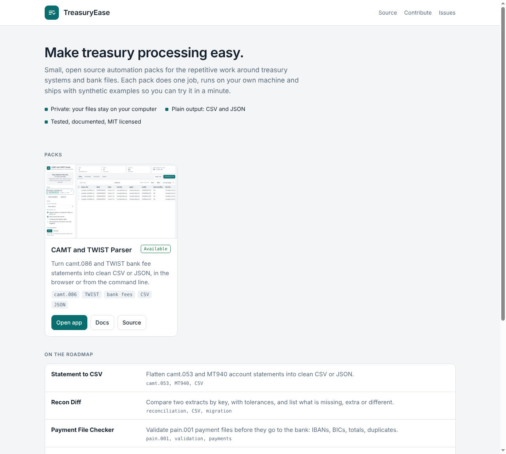

# TreasuryEase

**Make treasury processing easy.**

Small, open source automation packs for the repetitive work around treasury systems and bank files. Each pack does one job, runs on your own machine and comes with synthetic examples so you can try it in a minute.



## Packs

| Pack | What it does | Status |
| --- | --- | --- |
| [CAMT and TWIST Parser](packs/camt-twist-parser/) | Turns camt.086 and TWIST bank fee statements into clean CSV or JSON, in the browser or from the command line. | Available |

On the roadmap: statement to CSV (camt.053, MT940), a recon diff for comparing extracts, a payment file checker, fee analytics, an FX rates loader and a load file builder. See [docs/ROADMAP.md](docs/ROADMAP.md).

## Principles

- **Private.** Files are processed on your computer. Packs make no network calls with your data.
- **Plain output.** CSV and JSON that open anywhere.
- **Small and focused.** One job per pack, with a short README that says what it does and what it does not.
- **Tested.** Every available pack has unit tests and golden output files.
- **Synthetic examples only.** No real statements, names, accounts or reference numbers in the repository, ever. CI checks for the common ones.
- **No lock-in.** Plain Python with no dependencies, and single-file browser apps with no build step.

## Quick start

Each pack has its own README. For the parser:

```bash
git clone https://github.com/sa-nishad/treasuryease.git
cd treasuryease/packs/camt-twist-parser
PYTHONPATH=src python -m camt_twist_parser samples/example-camt086.xml -o fees.csv
```

Or open `packs/camt-twist-parser/web/index.html` in a browser and drop a file on it. The hosted site is at `https://sa-nishad.github.io/treasuryease/`.

## Repository layout

```
packs/                One folder per pack (code, tests, samples, docs)
  camt-twist-parser/  Pack 1
  _template/          Starting point for a new pack
catalog/planned.json  Ideas shown on the site's roadmap
docs/                 Pack guide, roadmap, naming, launch checklist
tools/                Pack checks, test runner, site builder, pack scaffolder
tests/                Tests for the tools
.github/               GitHub Actions (checks, tests, Pages) and issue templates
```

## Add a pack

```bash
python tools/new_pack.py fee-analytics "Fee Analytics" "Trend bank fees month on month."
```

Then follow the [pack guide](docs/PACK_GUIDE.md). Before opening a pull request, run:

```bash
python tools/check_packs.py
python tools/run_tests.py
```

## Contributing

Packs, fixes, format support and **anonymised sample files** are all welcome. Start with [CONTRIBUTING.md](CONTRIBUTING.md). Please read [SECURITY.md](SECURITY.md) before attaching any file to an issue.

## Disclaimer

TreasuryEase is an independent open source project. ISO 20022, TWIST and other standard or product names belong to their owners and are used only to describe what the packs read or write. It is not affiliated with or endorsed by any standards body, bank or software vendor. The software is provided as is, without warranty. Check results against the source before relying on them for accounting, reconciliation or payments.

## Licence

[MIT](LICENSE)
