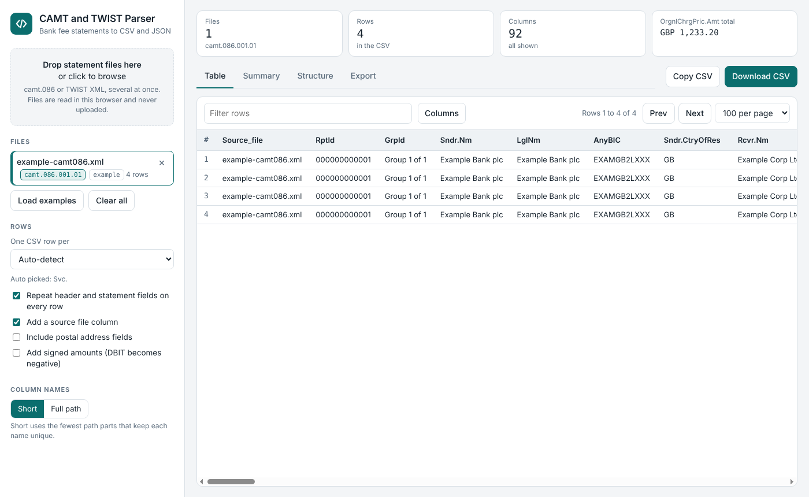
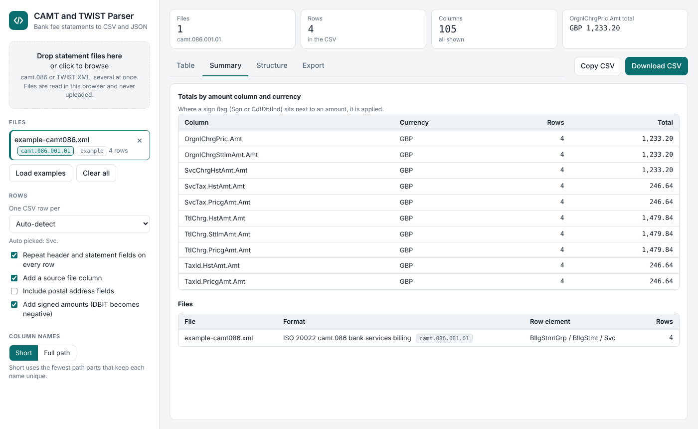
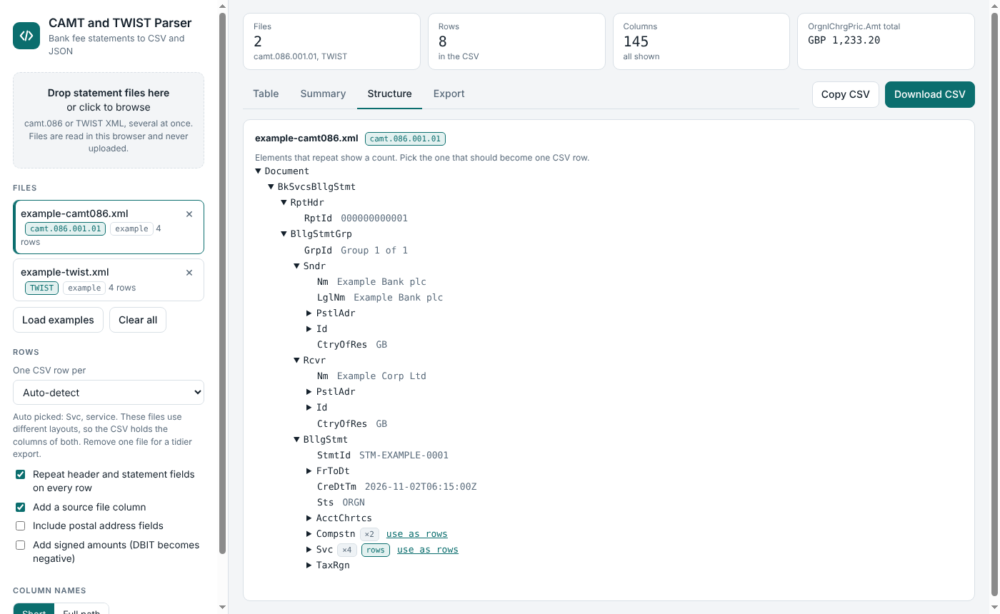
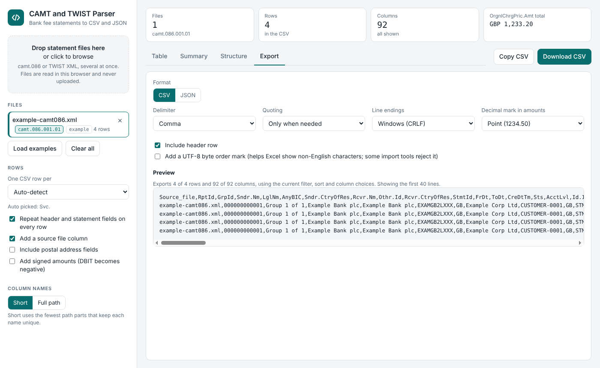
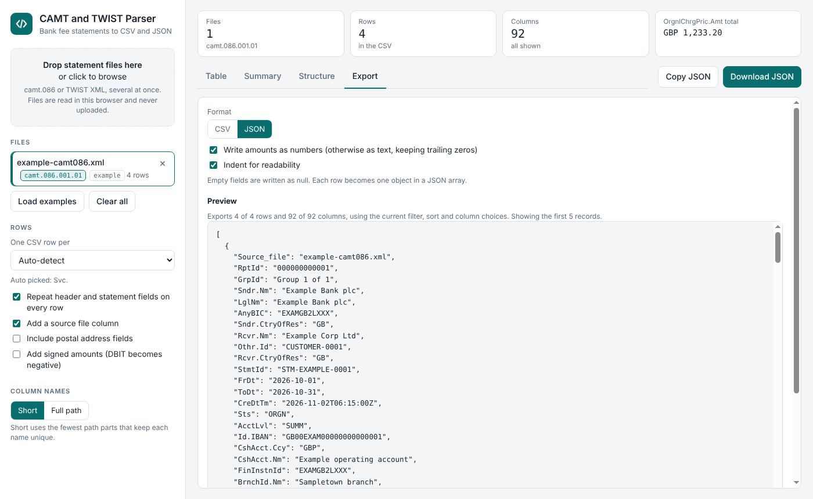
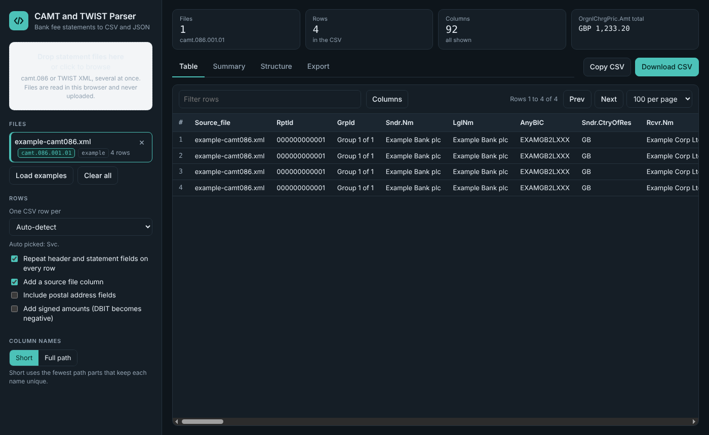

# CAMT and TWIST Parser

> A pack in [TreasuryEase](../../README.md): small, private, open source tools that make treasury processing easy.

Turn **camt.086** and **TWIST** bank service billing XML into clean **CSV or JSON**. Use it in the browser with drag and drop, or from the command line.

Bank fee statements arrive as deeply nested XML. This tool flattens them into one row per fee line, with the header and statement fields repeated on every row, so you can open the result in Excel, load it into a database or reconcile it against what your treasury system posted.



## Features

- **Two formats, one tool.** ISO 20022 camt.086 (bank services billing statement) and TWIST bank service billing. Other XML works too through generic flattening.
- **Automatic row detection.** It finds the repeating fee or service element (`Svc` in camt.086, `service` in TWIST) and ignores balance and compensation lines. You can override it.
- **Self-contained rows.** Header, report period and statement fields are repeated on every row. Turn this off if you prefer.
- **Readable column names.** `Chrg.Amt`, `Tax[1].Amt_Ccy`, not 90-character paths. Switch to full paths any time.
- **Totals by currency.** A quick check that your CSV adds up to the statement. Currency is read from the amount's `Ccy` attribute or from the currency field next to it.
- **Signs handled.** Totals respect the sign flag (`Sgn`, or the credit/debit indicator), and an optional column writes debits as negative numbers.
- **Quiet by default.** Postal addresses are left out; tick one box (or pass `--include-addresses`) to add them.
- **CSV and JSON.** Choose the delimiter, quoting, line endings, decimal comma and a byte order mark for Excel. JSON writes amounts as numbers and gaps as `null`.
- **Private.** The web app runs in your browser. Nothing is uploaded.
- **No dependencies.** The Python tool uses only the standard library.

| Summary | Structure |
| --- | --- |
|  |  |

| CSV export | JSON export |
| --- | --- |
|  |  |

The interface follows your light or dark setting:



## Quick start

### Web app

Open [`web/index.html`](web/index.html) in any modern browser, or use the hosted copy on the TreasuryEase site:
`https://sa-nishad.github.io/treasuryease/packs/camt-twist-parser/`

1. Drop one or more XML files onto the page.
2. Check the table and the Summary tab.
3. Open **Export**, choose CSV or JSON, then **Download**.

The app opens with two synthetic example files so you can try it straight away.

### Command line

```bash
pip install .            # run inside packs/camt-twist-parser of a clone

camt-twist-parser samples/example-camt086.xml -o fees.csv
camt-twist-parser samples/example-camt086.xml -o fees.json
camt-twist-parser a.xml b.xml --signed --summary > combined.csv
```

Without installing:

```bash
PYTHONPATH=src python -m camt_twist_parser samples/example-camt086.xml
```

Useful options:

| Option | What it does |
| --- | --- |
| `-o FILE` | Write to a file. A `.json` extension selects JSON. |
| `-f csv\|json` | Choose the format explicitly. |
| `--row-element NAME` | Use this element as one row, for example `Svc` or `Stmt`. |
| `--list-elements` | Show candidate row elements and exit. |
| `--no-context` | Do not repeat header and statement fields on every row. |
| `--signed` | Add signed amount columns. |
| `--include-addresses` | Include postal address fields (skipped by default). |
| `--naming full` | Use full paths as column names. |
| `--delimiter semicolon` | `comma`, `semicolon`, `tab` or `pipe`. |
| `--decimal-comma` | Write `1234,50` instead of `1234.50`. |
| `--bom` | Add a UTF-8 byte order mark so Excel reads non-English characters. |
| `--summary` | Print row counts and totals per currency to standard error. |

### As a library

```python
from camt_twist_parser import parse_xml, build_table, to_csv

table = build_table([parse_xml("statement.xml")], signed=True)
print(to_csv(table))
```

## How it works

1. Detect the format from the namespace or root element.
2. Count every element path and note which ones carry amounts.
3. Pick the repeating element with amounts that sits highest in the tree, such as `Svc`.
4. Flatten each of those elements into a row, adding the fields of its ancestors.
5. Index repeated children consistently (`Tax[1]`, `Tax[2]`) so every row has the same columns.
6. Shorten column names to the fewest path parts that stay unique.

The browser app and the Python tool implement the same algorithm and are checked against each other. See [docs/HOW_IT_WORKS.md](docs/HOW_IT_WORKS.md).

## Status and limits

This is version 0.1. It has been checked against synthetic files and against a private set of real bank files covering camt.086.001.01, camt.086.001.02 and TWIST 3.1 electronic billing from three banks. That set is not published, and it is still a small sample. Banks vary in how they use these formats, which is why the parser flattens by structure instead of relying on fixed field paths.

If a file does not parse the way you expect, open an issue with an **anonymised** sample. See [SECURITY.md](../../SECURITY.md) and [docs/FORMATS.md](docs/FORMATS.md).

The Python tool does not read formats other than XML, and it holds the whole file in memory.

## Repository layout

```
web/index.html            Browser app (single file, no build step)
pack.json                 Metadata used by the TreasuryEase site and checks
src/camt_twist_parser/    Python package and command-line tool
tests/                    Unit tests (python -m unittest discover -s tests)
samples/                  Synthetic example files and expected output
docs/                     How it works, format notes, screenshots
```

## Contributing

Format coverage grows with real-world examples. Anonymised samples, bug reports and pull requests are all welcome. Start with the repository's [CONTRIBUTING.md](../../CONTRIBUTING.md), then [DEVELOPMENT.md](DEVELOPMENT.md) for this pack.

## Disclaimer

ISO 20022 and TWIST are names of standards owned by their respective organisations. This project is independent and is not affiliated with or endorsed by them or by any bank. The example files are synthetic and contain no real data. The software is provided as is, without warranty, so check the output against the source statement before relying on it for accounting or payments.

## Licence

[MIT](../../LICENSE)
